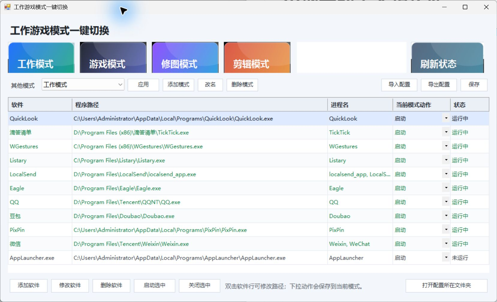

# 工作游戏模式一键切换

**工作游戏模式一键切换**（WorkGameModeSwitcher）是一个轻量的 Windows 桌面工具，用一套可编辑的软件启动、关闭规则，快速切换工作、游戏、修图、剪辑等使用场景。使用 C# 和 Windows Forms 开发，提供中文界面。

> 此处的“模式”是软件运行组合，不会调整 Windows 游戏模式、显卡设置或电源计划，也不承诺提升游戏帧率。

## 软件截图



## 主要功能

- 一键应用工作、游戏、修图和剪辑模式；支持添加、重命名、删除自定义模式。
- 为每个模式配置软件的启动、关闭或保持不变规则。
- 添加、修改和删除软件，支持拖入程序或快捷方式。
- 查看软件运行状态，手动启动或关闭软件。
- 导入、导出 XML 配置，方便备份及更换电脑。
- 提供当前用户安装程序，可创建桌面及开始菜单入口；升级时保留现有配置。

## 下载与使用

适用于安装了 .NET Framework 4.x 的 Windows。当前版本已在本机完成编译；尚未进行跨 Windows 版本兼容性验证。

- **直接运行**：[下载 WorkGameModeSwitcher.exe](https://github.com/qq77890203-afk/WorkGameModeSwitcher/raw/refs/heads/main/WorkGameModeSwitcher.exe)，放到自己有写入权限的文件夹后双击运行。
- **安装使用**：下载仓库 ZIP 并解压，确保 `Setup-ModeSwitcher.exe` 和 `WorkGameModeSwitcher.exe` 在同一文件夹，再运行安装程序。默认安装到当前用户目录。

首次启动会在程序旁生成 `modes.config.xml`。请先检查默认软件路径及每个模式的规则，按自己的电脑修改；预置的软件只是示例，不随本项目提供。游戏模式默认关闭所管理的软件，不会自动启动游戏。

**切换前请保存文档。** 关闭操作会先请求退出，约 400 毫秒后仍未退出的进程可能被强制结束，未保存内容可能丢失。请勿把关键系统进程加入关闭列表。

配置导出后可以在另一台电脑导入，但软件安装路径仍需重新检查。配置文件可能包含个人路径，不建议直接公开上传。自定义安装位置时，建议手动卸载；现有卸载脚本仅针对默认安装目录。

## 从源码编译

需要 Windows、PowerShell 和 .NET Framework 4.x 自带的 C# 编译器，无需额外 NuGet 包。

```powershell
git clone https://github.com/qq77890203-afk/WorkGameModeSwitcher.git
cd WorkGameModeSwitcher
powershell -NoProfile -ExecutionPolicy Bypass -File .\build.ps1
```

编译后会在项目目录生成 `WorkGameModeSwitcher.exe` 和 `Setup-ModeSwitcher.exe`。安装程序与主程序必须一起分发；安装程序优先查找同目录中的历史版本名称，因此请勿混放旧版 EXE。

## 项目文件

| 文件 | 用途 |
| --- | --- |
| `OneKeyModeManager.cs` | 主程序、模式规则、软件管理和配置读写 |
| `Installer.cs` | 当前用户安装程序及快捷方式创建 |
| `mode-switcher.ico` | 程序图标 |
| `build.ps1` | 可重复执行的编译入口 |
| `WorkGameModeSwitcher.exe` | 从本仓库源码编译的主程序 |
| `Setup-ModeSwitcher.exe` | 从本仓库源码编译的安装程序 |

本仓库以先前 v8 阶段源码为基础整理。原始开发目录及历史版本未改动；发布源码中的个人工作目录示例已替换为通用路径，并重新编译。未包含本机的个人配置或其他第三方软件。

## 参与开发

欢迎通过 [Issues](https://github.com/qq77890203-afk/WorkGameModeSwitcher/issues) 反馈问题或提出功能建议，也欢迎 Fork 项目并提交 Pull Request。修改建议由仓库维护者审核后合并。

其他 AI 或开发者可以阅读本仓库源码和编译步骤继续开发。提交前请运行 `build.ps1`，并在 Windows 上验证涉及的功能；涉及关闭进程的验证请使用专门的测试程序。不要提交账号凭据、个人配置或本机私有路径。

## 许可证

采用 [MIT License](LICENSE)。允许使用、修改和分发，包括商业使用；分发时需保留版权及许可声明。软件按现状提供。

